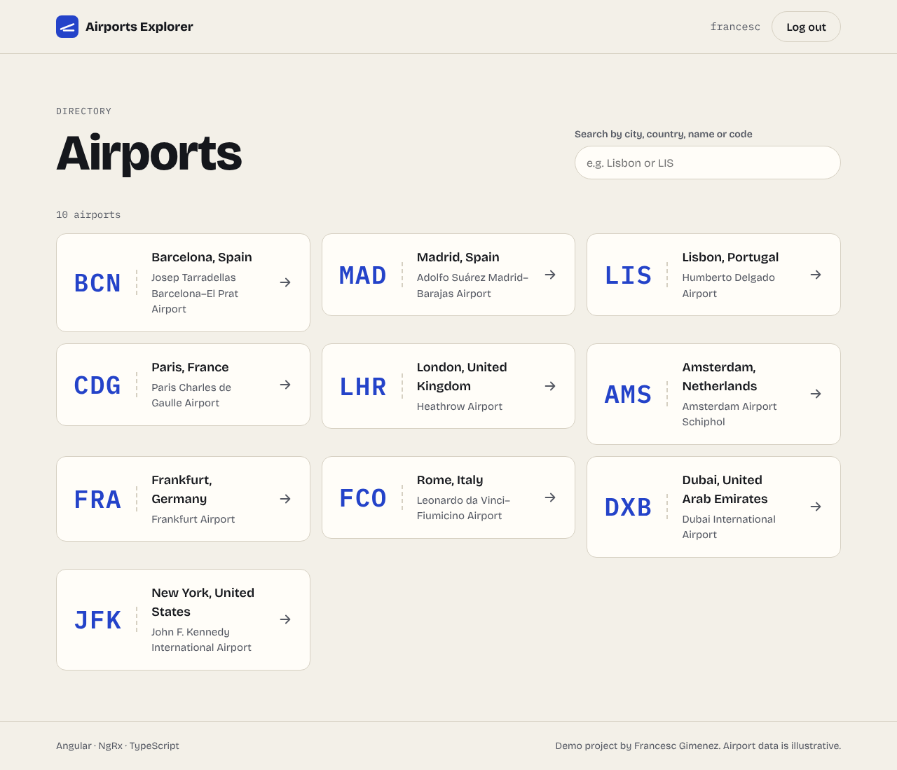
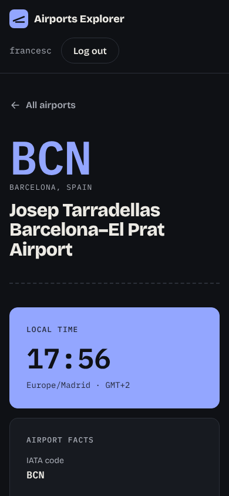

# Airports Explorer

A small Angular app to browse international airports: sign in, search the directory and open each airport to see its codes, operator, coordinates and live local time.

I built it to practise a realistic Angular setup end to end: standalone components, signals, NgRx for app state, functional guards and interceptors, lazy-loaded routes and unit tests.

**Live demo:** https://franziskus16.github.io/angular-airports-explorer/ (sign in with any username and password)



| Airport detail | Mobile, dark mode |
| --- | --- |
|  |  |

## Features

- **Sign in and session handling.** A reactive form with validation creates a session with a random security key. The session lives in the NgRx store and survives a page reload (sessionStorage), but not closing the tab.
- **Protected routes.** `authGuard` sends guests to the login page and remembers where they were going; `guestGuard` keeps signed-in users away from the login page.
- **Security key on every request.** A functional HTTP interceptor reads the key from the store and adds it as a header.
- **Search.** Filters by code, city, country or name as you type, ignoring case and accents.
- **Airport detail.** Big IATA code, key facts, a link to the map and the current local time in the airport's time zone.
- **Loading, empty and error states**, each announced to screen readers, with a retry button on errors.
- **Accessible by default.** Semantic HTML, real links and buttons, labelled inputs, visible focus, skip link, colour contrast checked in light and dark mode, and reduced-motion support.

## Tech

- Angular 22 (standalone components, signals, `rxResource`, new control flow, OnPush everywhere)
- NgRx Store (`createFeature`, `createActionGroup`, a meta-reducer for session persistence)
- TypeScript in strict mode
- SCSS with design tokens as CSS custom properties, light and dark themes
- Vitest for unit tests
- GitHub Actions: tests, build and deploy to GitHub Pages on every push to `main`

## Project structure

```
src/app
├── airports/
│   ├── airport.model.ts           # AirportSummary and Airport types
│   ├── airports.service.ts        # data access
│   ├── airport-card/              # reusable boarding-pass card
│   ├── airports-list/             # directory page + search
│   └── airport-detail/            # detail page + local time
├── auth/
│   ├── store/                     # actions, reducer, selectors, session meta-reducer
│   ├── auth.guards.ts             # authGuard and guestGuard
│   ├── security-key.interceptor.ts
│   └── login/                     # sign-in page
├── shared/status-message/         # loading / empty / error states
├── app.config.ts                  # providers: router, http, store
└── app.routes.ts                  # lazy-loaded routes
```

## Data

There is no backend: the "API" is a set of static JSON files in `public/data`, so the app can be hosted on GitHub Pages. `AirportsService` is the only place that knows about it, so switching to a real API means changing its `baseUrl`. The airport data is illustrative.

## Running it

Requires Node 22.22.3+ or 24+.

```bash
npm install
npm start          # http://localhost:4200
npm run test:ci    # unit tests
npm run build      # production build
```
